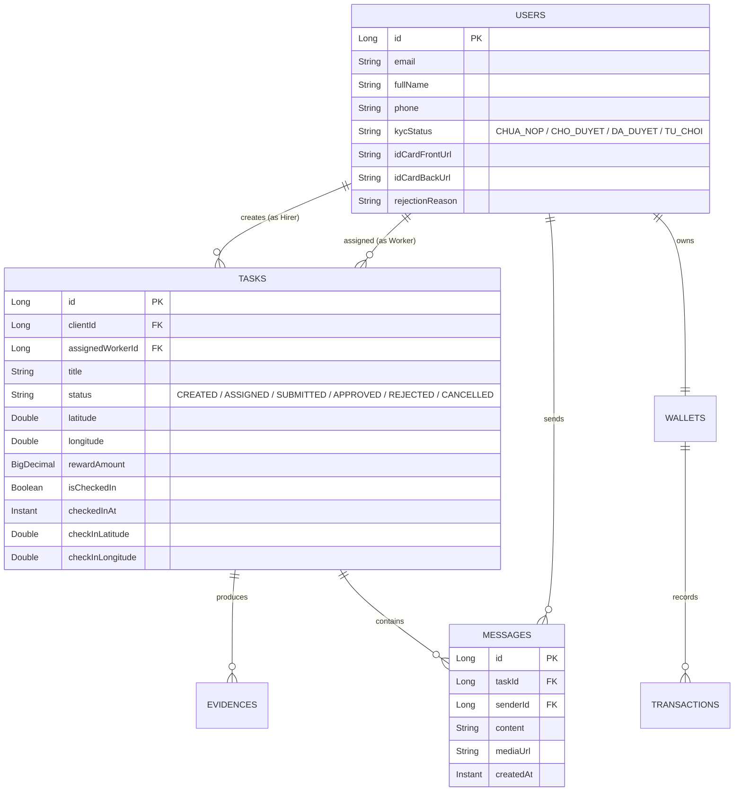

# KẾ HOẠCH TRIỂN KHAI KỸ THUẬT & DANH MỤC BACKLOG (TECH ROADMAP)
## DỰ ÁN: NỀN TẢNG "TÔI ĐÂY" (IM-HERE) — THEO BRD V2.0
**Ngày lập:** 13/10/2026  
**Nguyên tắc triển khai:** Phần nào thiếu dịch vụ bên thứ ba (SMS OTP, Email SMTP, Cổng thanh toán, Cloud Storage S3) $\rightarrow$ **Mock hoàn chỉnh luồng chạy và đánh dấu Note rõ ràng** để dễ dàng plug-in khi có API key thực tế.

---

## 1. DANH MỤC CÁC HẠNG MỤC CẦN MOCK (MOCK SERVICES & THIRD-PARTY)

| Hạng mục | Thực tế sản xuất (Production) | Phương án Mock hiện tại (Phase 1) | Ghi chú & Điểm cắm (Plug-in Point) |
|---|---|---|---|
| **Gửi Email / OTP** | Gửi qua SendGrid / Amazon SES / Brevo | In token/OTP ra Console log hệ thống; tự động pass kiểm tra nếu nhập code test `123456`. | Sẵn sàng Interface `EmailService.java`. Khi có SMTP/API Key chỉ cần thay implementation. |
| **Lưu trữ Ảnh CCCD & Bằng chứng** | AWS S3 / Cloudinary / MinIO | Lưu ảnh dưới dạng Base64 hoặc Mock URL `https://mock-storage.imhere.vn/uploads/...` / Static public folder. | Interface `StorageService`. Có thể tích hợp S3 SDK khi có Bucket credentials. |
| **Cổng thanh toán Nạp tiền** | PayOS / VNPay / MoMo Webhook | Tạo mã QR VietQR tĩnh hoặc Form giả lập nạp tiền: Bấm "Xác nhận nạp" là hệ thống tự cộng số dư ví. | Endpoint `/api/wallet/deposit` xử lý trực tiếp nội bộ. |
| **Bản đồ & GPS Geocoding** | Google Maps Platform API / Mapbox API | Sử dụng OpenStreetMap (OSM) / Leaflet miễn phí; toạ độ GPS lấy trực tiếp từ `navigator.geolocation` của trình duyệt. | Không tốn phí API key của Google. |
| **Tin nhắn Real-time** | WebSocket + STOMP (Spring Boot) | Kết hợp Spring WebSocket STOMP cục bộ + Fallback REST Polling lưu trong PostgreSQL. | Hoạt động ngay trên localhost không phụ thuộc hạ tầng đám mây. |

---

## 2. DANH MỤC CÔNG VIỆC KỸ THUẬT (ACTIONABLE SPRINT BACKLOG)

### SPRINT 1: Backend Spring Boot — Củng cố Core Model & Logic (P0)

#### 1. Module User & KYC:
* [x] **Entity User:** Bổ sung các trường:
  * `kycStatus`: `CHUA_NOP`, `CHO_DUYET`, `DA_DUYET`, `TU_CHOI`.
  * `idCardFrontUrl`: String (Ảnh mặt trước CCCD).
  * `idCardBackUrl`: String (Ảnh mặt sau CCCD).
  * `rejectionReason`: String (Lý do từ chối nếu có).
  * `activeRole`: `HIRER` hoặc `WORKER` (mặc định cho phép chuyển đổi linh hoạt).
* [ ] **API User:**
  * `POST /api/users/kyc`: Nộp ảnh CCCD (Mock upload nhận URL/Base64).
  * `PATCH /api/users/switch-role`: Chuyển đổi giao diện làm việc hiện tại.
* [ ] **API Admin KYC:**
  * `GET /api/admin/kyc/pending`: Lấy danh sách hồ sơ chờ duyệt.
  * `POST /api/admin/kyc/{id}/review`: Phê duyệt hoặc từ chối (kèm lý do).

#### 2. Module Task — Quy trình Thực địa 2 chặng & Chống race condition:
* [x] **Khóa nhận việc 2 tầng (Two-Tier Concurrency Lock):**
  * Tầng 1: **Redis Distributed Lock (SETNX)** với TTL 5 giây chặn spam đa server.
  * Tầng 2: **PostgreSQL Pessimistic Write Lock (`findByIdWithLock`)** chặn triệt để race condition trong DB.
  * Kiểm tra điều kiện: User phải có trạng thái KYC hợp lệ mới được nhận việc.
  * Kiểm tra điều kiện: User phải có `kycStatus == DA_DUYET` mới được nhận việc.
* [ ] **Entity Task & Chặng 1 Check-in GPS:**
  * Bổ sung trường: `checkedInAt` (Instant), `checkInLatitude` (Double), `checkInLongitude` (Double), `isCheckedIn` (Boolean).
  * Viết API: `POST /api/tasks/{id}/check-in`:
    * Nhận tọa độ thực tế của Worker.
    * Tính khoảng cách Haversine so với điểm task.
    * Nếu $\le 100\text{ m}$: Cập nhật `isCheckedIn = true`, `checkedInAt = now()`.
    * Nếu $> 100\text{ m}$: Trả về lỗi `400 BAD_REQUEST: Bạn đang cách địa điểm X mét (yêu cầu <= 100m)`.
* [ ] **Chặng 2 Nộp Bằng chứng (Evidence):**
  * Ràng buộc API `POST /api/evidences/submit`: Bắt buộc `task.getIsCheckedIn() == true` mới cho nộp.

#### 3. Module Chat — Real-time Task Messaging:
* [ ] **Entity Message:**
  * `id`, `taskId`, `senderId`, `content`, `mediaUrl`, `createdAt`.
* [ ] **WebSocket & REST APIs:**
  * Cấu hình WebSocket Message Broker (`/ws` và topic `/topic/task/{taskId}`).
  * API: `GET /api/tasks/{taskId}/messages` (Lấy lịch sử chat khi vào phòng).
  * API: `POST /api/tasks/{taskId}/messages` (Gửi tin nhắn qua REST làm fallback).

---

### SPRINT 2: Frontend Next.js — Trải nghiệm C2C & Giao diện Tinh gọn (P1)

#### 1. Header & Điều hướng Toàn hệ thống:
* [ ] **Nút chuyển đổi chế độ làm việc (Role Switcher):**
  * Header có nút bật tắt nhanh: **[Chế độ Thuê việc]** $\longleftrightarrow$ **[Chế độ Nhận việc]**.
  * Chuyển tab tự động điều hướng: Thuê việc $\rightarrow$ Portal Client / Đăng task; Nhận việc $\rightarrow$ Portal Looker / Bản đồ tìm việc.
* [ ] Hiển thị **Ví chung duy nhất** trên thanh menu cho cả 2 vai trò.

#### 2. Giao diện Nhận việc & Thực thi 2 chặng (Worker Flow):
* [ ] **Màn hình Nộp KYC (`/looker/onboarding`):**
  * Cho phép chọn ảnh hoặc xem mock CCCD mẫu, nộp hồ sơ, hiển thị trạng thái chờ duyệt.
* [ ] **Màn hình Chi tiết Task (`/looker/listing/[id]`):**
  * Nếu chưa KYC: Ẩn nút "Nhận việc" hoặc thông báo yêu cầu KYC.
  * Sau khi nhận việc: Hiển thị 2 bước rõ ràng:
    * **Bước 1:** Nút **"Bấm Check-in tại điểm (Bán kính 100m)"** (Lấy vị trí thiết bị qua Browser Geolocation).
    * **Bước 2 (Bị khóa cho đến khi Check-in xong):** Nút **"Mở Form Checklist & Chụp ảnh"**.
* [ ] **Khung Chat Real-time trong Nhiệm vụ:**
  * Tích hợp chat box nổi hoặc tab Chat riêng trong màn hình thực thi nhiệm vụ giữa Người thuê và Người nhận.

#### 3. Tinh gọn Giao diện Quản trị Admin:
* [ ] Tinh chỉnh menu Sidebar Admin chỉ còn **3 mục chính**:
  1. `/admin/tasks`: Giám sát toàn bộ nhiệm vụ (xem GPS, bằng chứng, can thiệp hủy/hoàn tiền).
  2. `/admin/workforce`: Xét duyệt hồ sơ CCCD (xem ảnh trước/sau, bấm Duyệt / Từ chối).
  3. `/admin/finance`: Quản lý giao dịch và duyệt các lệnh rút tiền.
* [ ] Ẩn các trang phụ chưa cần thiết: `/admin/fraud`, `/admin/categories`, `/admin/qa` (đưa các chức năng trọng yếu vào màn hình chi tiết nhiệm vụ).

---

## 3. THIẾT KẾ CƠ SỞ DỮ LIỆU ĐIỀU CHỈNH (MINDMAP SCHEMA)

