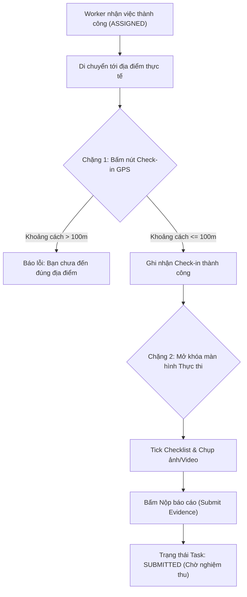
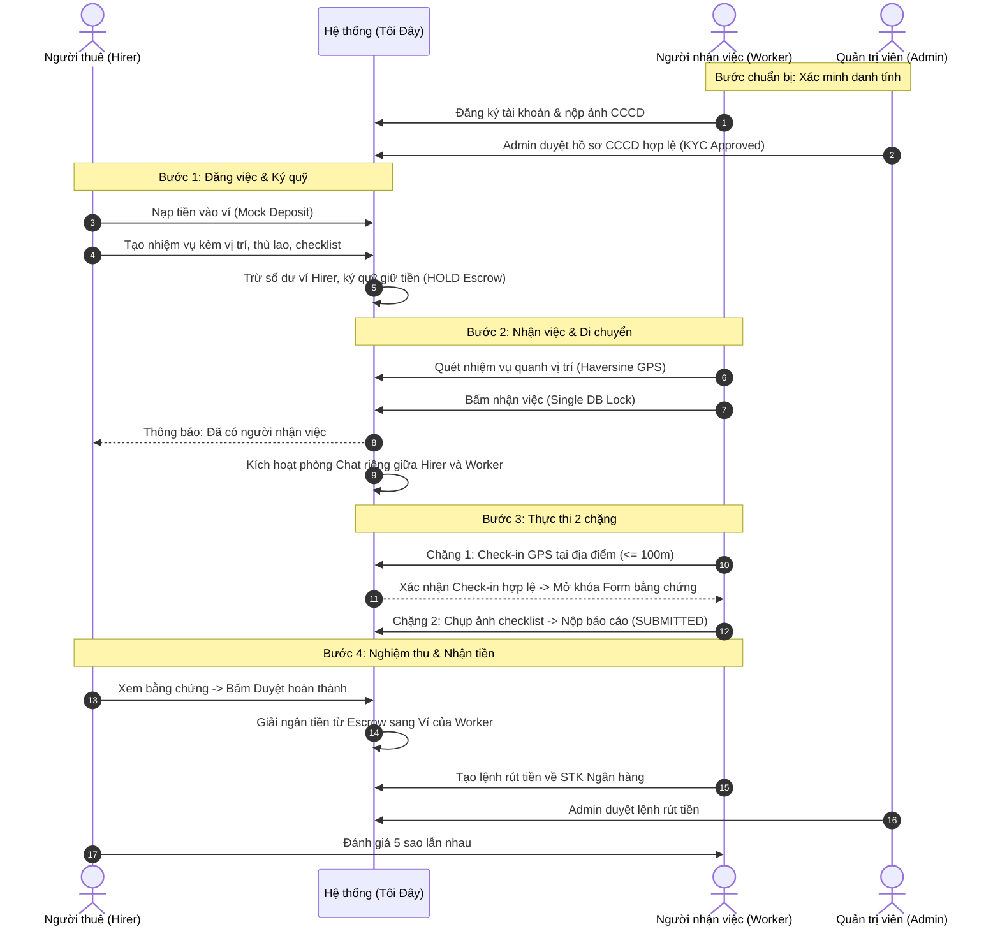

# TÀI LIỆU YÊU CẦU NGHIỆP VỤ (BRD v2.0)
## DỰ ÁN: NỀN TẢNG "TÔI ĐÂY" (IM-HERE)
**Phiên bản:** 2.0 (Đã đồng bộ và phê duyệt theo quyết định nghiệp vụ thực tế)  
**Ngày cập nhật:** 13/10/2026  
**Mô hình kinh doanh:** C2C / P2P Gig Economy Platform (Nền tảng kết nối việc vặt thực địa quanh vị trí)

---

## 1. TỔNG QUAN DỰ ÁN & MÔ HÌNH VẬN HÀNH

### 1.1. Mục tiêu
"Tôi Đây" là nền tảng kết nối giữa **Người thuê (Hirer)** có nhu cầu kiểm tra, xác minh, thu thập thông tin hoặc thực hiện công việc tại một địa điểm thực tế và **Người nhận việc (Worker / Shepherd)** đang ở gần vị trí đó.

### 1.2. Nguyên tắc cốt lõi
1. **Một tài khoản - Hai vai trò:** Người dùng chỉ cần đăng ký 1 tài khoản duy nhất, có thể linh hoạt chuyển đổi giữa vai trò Đăng việc (Hirer) và Nhận việc (Worker).
2. **Ký quỹ đảm bảo (Internal Escrow):** Người thuê trả tiền trước cho hệ thống $\rightarrow$ Hệ thống tạm giữ (Hold) $\rightarrow$ Người nhận việc làm đúng quy trình và được nghiệm thu $\rightarrow$ Hệ thống tự động giải ngân thù lao vào ví người nhận việc.
3. **Thực thi 2 chặng nghiêm ngặt:** Bắt buộc Check-in GPS trong bán kính $\le 100\text{ m}$ mới được mở khóa bước chụp ảnh & gửi báo cáo hoàn thành.
4. **Minh bạch qua Chat Real-time:** Tích hợp phòng chat riêng cho từng nhiệm vụ giữa 2 bên để cập nhật tiến độ, hỗ trợ định vị và làm bằng chứng đối soát khi có tranh chấp.

---

## 2. BẢNG MA TRẬN PHÂN HỆ CHỨC NĂNG (FEATURE MATRIX)

| Mã | Phân hệ | Tóm tắt mô tả nghiệp vụ |
|:---:|---|---|
| **AUTH** | Xác Thực & Hồ Sơ | Đăng ký/Đăng nhập bằng Email + Mật khẩu. Một tài khoản đóng 2 vai trò linh hoạt. Upload CCCD để xác minh danh tính. |
| **KYC** | Duyệt Hồ Sơ Worker | Admin xem xét ảnh CCCD. Phê duyệt thành công mới được quyền bấm nhận việc. |
| **TASK** | Đăng & Quản Lý Việc | Ghim vị trí bản đồ, đặt tiền thù lao, deadline, checklist yêu cầu, ghi chú hướng dẫn. Tiền được tự động ký quỹ từ ví. |
| **MATCH** | Tìm & Nhận Việc | Tìm việc quanh vị trí qua bản đồ GPS (công thức Haversine). Nhận việc độc quyền (chống race condition 1 việc nhiều người nhận). |
| **EXEC** | Thực Thi 2 Chặng | **Chặng 1:** Bắt buộc Check-in GPS tại điểm ($\le 100\text{ m}$). **Chặng 2:** Mở khóa form chụp ảnh/video + tick checklist $\rightarrow$ Nộp bằng chứng. |
| **CHAT** | Chat Real-time | Nhắn tin trực tiếp giữa Người thuê và Người nhận trong phạm vi từng nhiệm vụ. Gửi ảnh và vị trí trực tiếp. |
| **FIN** | Ví Ảo & Ký Quỹ (Escrow) | Nạp tiền vào ví, Ký quỹ tạm giữ khi tạo task, Giải ngân khi nghiệm thu thành công, Hoàn tiền khi hủy, Rút tiền về STK ngân hàng. |
| **REV** | Nghiệm Thu & Đánh Giá | Người thuê duyệt bằng chứng $\rightarrow$ Kích hoạt trả tiền (hoặc yêu cầu làm lại). Cơ chế timeout tự động duyệt sau 24h. Đánh giá 2 chiều 1–5 sao. |
| **ADM** | Quản Trị Tinh Gọn (3 Module) | **1. Quản lý Nhiệm vụ** (Chi tiết task, timeline, can thiệp hủy/hoàn tiền). **2. Duyệt Worker KYC** (Xem CCCD, duyệt/từ chối kèm lý do). **3. Quản lý Tài chính** (Duyệt rút tiền, sổ cái giao dịch). |

---

## 3. ĐẶC TẢ CHI TIẾT CÁC PHÂN HỆ NGHIỆP VỤ

### 3.1. Phân hệ AUTH: Xác thực & Quản lý Tài khoản
* **Phương thức:** Email & Mật khẩu (JWT Authentication). Hỗ trợ đăng ký, đăng nhập, đổi mật khẩu.
* **Cơ chế 2 vai trò trên 1 tài khoản:**
  * Người dùng có nút **Chuyển chế độ** (Toggle Role: "Chế độ Thuê việc" $\leftrightarrow$ "Chế độ Nhận việc").
  * Một tài khoản sở hữu duy nhất 1 số dư ví (Balance) dùng chung cho cả việc trả tiền đăng task lẫn nhận tiền thù lao.
* **Hồ sơ cá nhân:** Họ tên, số điện thoại liên hệ, ảnh đại diện, địa bàn hoạt động.

### 3.2. Phân hệ KYC: Phê duyệt Người nhận việc
* **Nộp hồ sơ:**
  * Người dùng muốn nhận việc phải tải lên: Ảnh mặt trước & mặt sau CCCD/CMND.
  * Trạng thái KYC của User: `CHUA_NOP` $\rightarrow$ `CHO_DUYET` $\rightarrow$ `DA_DUYET` / `TU_CHOI`.
* **Ràng buộc nghiệp vụ:**
  * Người thuê đăng việc: Không bắt buộc KYC (chỉ cần có số dư trong ví để ký quỹ).
  * Người nhận việc: Bắt buộc trạng thái `DA_DUYET` mới xuất hiện nút "Nhận việc".

### 3.3. Phân hệ TASK: Đăng nhiệm vụ & Ký quỹ
* **Thông tin nhiệm vụ:**
  * Tiêu đề, danh mục (Kiểm tra hàng, Xác minh địa chỉ, Mua hộ, Việc vặt...).
  * Địa chỉ thực hiện + Tọa độ GPS (Kéo thả ghim trên bản đồ hoặc gõ địa chỉ).
  * Số tiền thù lao (VNĐ) trả cho người nhận việc.
  * Hạn chót hoàn thành (Deadline).
  * Checklist công việc: Danh sách các đầu mục cần hoàn thành, đánh dấu mục nào bắt buộc chụp ảnh.
  * Hướng dẫn chi tiết / Lưu ý cho người làm.
* **Quy tắc Ký quỹ tự động (Escrow Hold):**
  * Ngay khi bấm "Đăng nhiệm vụ", hệ thống kiểm tra số dư ví của Người thuê.
  * Nếu $\text{Số dư ví} \ge \text{Tiền thù lao}$: Trừ số dư khả dụng, cộng vào `escrowBalance` của nhiệm vụ. Trạng thái task chuyển thành `OPEN`.
  * Nếu không đủ tiền: Báo lỗi và điều hướng sang màn hình Nạp tiền.

### 3.4. Phân hệ MATCH: Tìm & Nhận việc
* **Tìm việc:** Quét các nhiệm vụ ở trạng thái `OPEN` xung quanh tọa độ hiện tại của Worker theo bán kính (1km, 3km, 5km, 10km) dựa trên công thức Haversine.
* **Nhận việc độc quyền (Single Assignment):**
  * Mỗi nhiệm vụ chỉ có duy nhất 1 Worker được nhận (`ASSIGNED`).
  * Sử dụng cơ chế khóa dữ liệu (Pessimistic Lock / Database Lock) tại thời điểm nhận việc để chống race condition khi nhiều người cùng bấm nhận tại 1 thời điểm.
  * Sau khi nhận việc, nhiệm vụ chuyển sang trạng thái `ASSIGNED` và tự động mở phòng Chat giữa 2 bên.

### 3.5. Phân hệ EXEC: Quy trình Thực thi 2 Chặng Nghiêm Ngặt
Quy trình thực hiện tại hiện trường bắt buộc tuân theo 2 chặng:

1. **Chặng 1 — Check-in GPS:**
   * Worker có mặt tại hiện trường và bấm nút **"Check-in tại điểm"**.
   * Hệ thống đối soát tọa độ thực tế của Worker với tọa độ nhiệm vụ:
     * Nếu $\text{Khoảng cách} \le 100\text{ m}$: Xác nhận check-in, lưu timestamp và tọa độ. Mở khóa giao diện Chặng 2.
     * Nếu $\text{Khoảng cách} > 100\text{ m}$: Từ chối thao tác, hiển thị khoảng cách còn thiếu.
2. **Chặng 2 — Hoàn thành Checklist & Gửi bằng chứng:**
   * Chỉ mở ra sau khi đã hoàn thành Chặng 1.
   * Worker tải ảnh/video thực tế theo từng mục checklist yêu cầu và tick xác nhận.
   * Bấm **"Gửi báo cáo hoàn thành"** $\rightarrow$ Hệ thống chuyển trạng thái nhiệm vụ sang `SUBMITTED`, gửi thông báo cho Người thuê vào nghiệm thu.

### 3.6. Phân hệ CHAT: Nhắn tin Thời gian thực (Real-time Task Chat)
* **Phạm vi:** Mỗi nhiệm vụ có một phòng chat duy nhất giữa Người thuê và Người nhận việc được kích hoạt ngay khi task chuyển sang `ASSIGNED`.
* **Tính năng:**
  * Nhắn tin tức thời (WebSocket / STOMP).
  * Gửi hình ảnh trực tiếp trong khung chat.
  * Gửi vị trí GPS hiện tại để Người thuê theo dõi lộ trình di chuyển.
  * Tin nhắn hệ thống tự động: Báo khi Worker bấm Check-in thành công, báo khi Worker nộp báo cáo.
* **Kiểm toán tranh chấp:** Toàn bộ lịch sử tin nhắn được lưu vĩnh viễn theo `taskId`, Admin có quyền truy cập làm bằng chứng phán quyết khi xảy ra khiếu nại.

### 3.7. Phân hệ FIN: Ví Ảo & Quản lý Dòng tiền (Mock Internal Flow)
* **Nguyên tắc:** Quản lý số dư nội bộ để kiểm thử toàn diện luồng ký quỹ và phân phối thù lao mà không cần phụ thuộc cổng thanh toán bên thứ ba ở Phase 1.
* **Chu kỳ dòng tiền:**
  1. **Nạp tiền (Deposit):** Người dùng nạp tiền vào ví nội bộ (Mock tính năng nạp tiền thành công).
  2. **Ký quỹ (Hold Escrow):** Khi tạo task, tiền được chuyển từ `Balance` sang `Escrow Balance`.
  3. **Giải ngân (Release Escrow):** Khi Người thuê duyệt báo cáo: Tiền trong `Escrow Balance` của Người thuê được giải phóng và chuyển thẳng vào `Balance` khả dụng của Worker.
  4. **Hoàn tiền (Refund Escrow):** Nếu task bị hủy hợp lệ hoặc Worker từ bỏ nhiệm vụ: Tiền ký quỹ tự động hoàn trả lại vào `Balance` của Người thuê.
  5. **Rút tiền (Withdraw):** Worker tạo yêu cầu rút tiền về số tài khoản ngân hàng $\rightarrow$ Trừ `Balance` $\rightarrow$ Đưa vào hàng đợi để Admin Finance duyệt thủ công.
* **Sổ cái giao dịch (Ledger):** Mọi giao dịch nạp, cọc, giải ngân, hoàn tiền, rút tiền đều được ghi nhận vào bảng `Transaction` bất biến (không sửa/xóa).

### 3.8. Phân hệ REV: Nghiệm Thu, Tranh Chấp & Đánh Giá
* **Nghiệm thu báo cáo:**
  * Người thuê kiểm tra ảnh chụp, video và checklist mà Worker gửi lên.
  * Có 2 lựa chọn:
    * **Chấp nhận (Approve):** Hệ thống lập tức kích hoạt lệnh giải ngân tiền cho Worker. Nhiệm vụ chuyển trạng thái `COMPLETED`.
    * **Yêu cầu làm lại (Reject/Rework):** Nhập lý do gửi lại cho Worker để bổ sung thêm bằng chứng.
* **Cơ chế Tự động duyệt (Auto-timeout):** Nếu Người thuê không phản hồi trong vòng **24 giờ** kể từ khi Worker nộp báo cáo, hệ thống tự động chuyển trạng thái `COMPLETED` và giải ngân tiền cho Worker nhằm bảo vệ quyền lợi người lao động.
* **Đánh giá 2 chiều (Review & Rating):**
  * Sau khi hoàn thành, hai bên chấm điểm cho nhau từ 1 đến 5 sao kèm nhận xét.
  * Điểm trung bình sao được hiển thị công khai trên hồ sơ cá nhân để xây dựng uy tín cộng đồng.

### 3.9. Phân hệ ADM: Cấu trúc Quản trị Admin Tinh Gọn (3 Module)
Gom gọn toàn bộ tính năng quản trị thành 3 màn hình nghiệp vụ trọng tâm:

1. **Module 1 — Quản lý Nhiệm vụ (Task & Dispute Center):**
   * Tra cứu danh sách toàn bộ nhiệm vụ theo trạng thái (`OPEN`, `ASSIGNED`, `SUBMITTED`, `COMPLETED`, `CANCELLED`).
   * Xem hồ sơ chi tiết từng nhiệm vụ: Tọa độ, lịch sử check-in, ảnh bằng chứng, lịch sử chat giữa 2 bên.
   * Can thiệp đặc biệt: Admin có quyền cưỡng chế Hủy nhiệm vụ, Hoàn tiền cho Người thuê hoặc Giải ngân cho Worker khi có khiếu nại.
2. **Module 2 — Quản lý & Duyệt Worker (Workforce KYC):**
   * Danh sách hồ sơ Worker đang chờ duyệt.
   * Xem ảnh mặt trước & mặt sau CCCD, họ tên thật, số điện thoại.
   * Nút hành động: **Phê duyệt** (mở quyền nhận việc) hoặc **Từ chối** (bắt buộc nhập lý do gửi đến người dùng).
   * Khóa / Mở khóa tài khoản khi phát hiện hành vi gian lận.
3. **Module 3 — Quản lý Tài chính & Đối soát (Finance & Withdrawal):**
   * Xem dòng tiền tổng quan hệ thống: Tổng tiền nạp, tổng tiền đang ký quỹ (Escrow), tổng tiền đã giải ngân.
   * Danh sách yêu cầu rút tiền của Worker: Xem tên, STK, ngân hàng, số tiền $\rightarrow$ Bấm nút "Xác nhận đã chuyển khoản" để hoàn tất rút tiền.

---

## 4. QUY TRÌNH NGHIỆP VỤ ĐẦU - CUỐI (END-TO-END FLOW)

---

## 5. DANH SÁCH BỔ SUNG KỸ THUẬT CẦN ĐIỀU CHỈNH NGAY

Để đưa mã nguồn hiện tại khớp 100% với BRD v2 này:
1. **Database Backend:**
   * Thêm trường `kycStatus`, `idCardFrontUrl`, `idCardBackUrl` vào bảng `User`.
   * Thêm bảng `Message` (taskId, senderId, content, imageUrl, createdAt) và cấu hình WebSocket/STOMP.
   * Thêm trường `checkedInAt`, `checkInLatitude`, `checkInLongitude` vào bảng `Task`.
2. **Logic Backend:**
   * Cập nhật `acceptTask` sử dụng DB Lock chống nhận trùng.
   * Viết API riêng `POST /api/tasks/{id}/check-in` để kiểm tra bán kính $\le 100\text{ m}$.
   * Mở API KYC Upload và Admin Duyệt KYC.
3. **Frontend Next.js:**
   * Bổ sung nút chuyển đổi vai trò (Hirer $\leftrightarrow$ Worker) tại thanh điều hướng.
   * Thêm màn hình Check-in chặng 1 trước khi mở camera chụp checklist chặng 2.
   * Gom cụm menu Admin chỉ còn 3 mục: Tasks, Workforce (KYC), Finance.
   * Xây dựng khung Chat trong trang chi tiết nhiệm vụ.